<div align="center">

# ◉ ORBIS
### World Intelligence Engine

**One terminal-style dashboard for what is happening on Earth and beyond.**
Markets · news · economies · hazards · space · science · cyber · aviation · history · forecasts


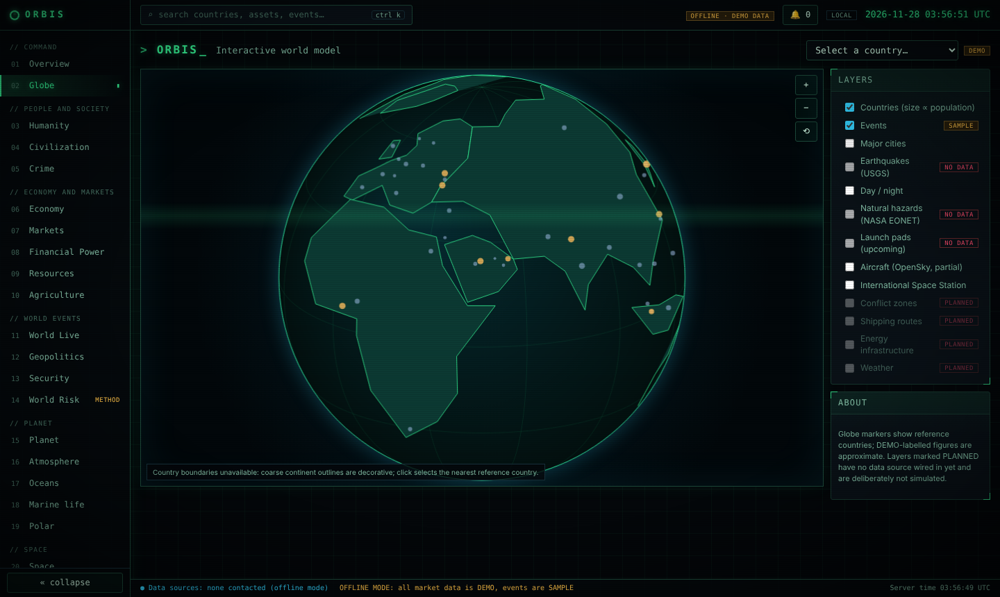

</div>

> **About the screenshots:** they were captured in `ORBIS_OFFLINE=1` mode because the build sandbox had no internet. Everything labelled DEMO or SAMPLE in them is placeholder data, and the app says so on screen. Run it on a networked machine to see real provider data.

## Quick start
Requires **Node 22 or newer**. There is nothing to install.

```bash
git clone https://github.com/luciferalive/ORBIS-THE-WORLD-ENGINE.git
cd ORBIS-THE-WORLD-ENGINE
cp .env.example .env        # optional: add API keys
node server/index.js        # open http://localhost:8090
```

| Command | What it does |
|---|---|
| `npm test` | 46 server tests (a fixture for every parser) |
| `ORBIS_OFFLINE=1 node server/index.js` | demo mode, no network, everything labelled |
| `ORBIS_SCHEDULER=0 node server/index.js` | disable the background recorder |
| `node scripts/gen-sources-doc.mjs` | regenerate `docs/DATA_SOURCES.md` |

## Look and feel
Terminal theme with a boot sequence (once per session, press any key to skip), neon-on-black panels, scanlines and a glowing globe. Motion is disabled automatically for `prefers-reduced-motion`. `Ctrl+K` or `/` opens the command palette.

| Overview | Globe layers |
|---|---|
| 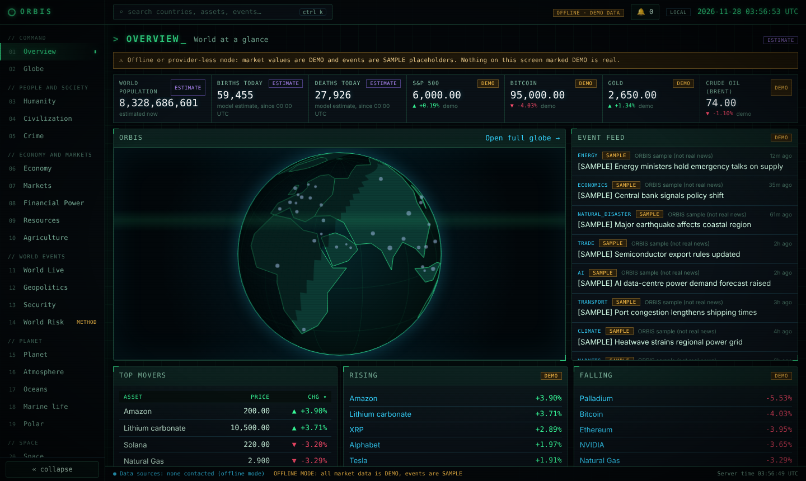 |  |

| Simulations | API Center |
|---|---|
| 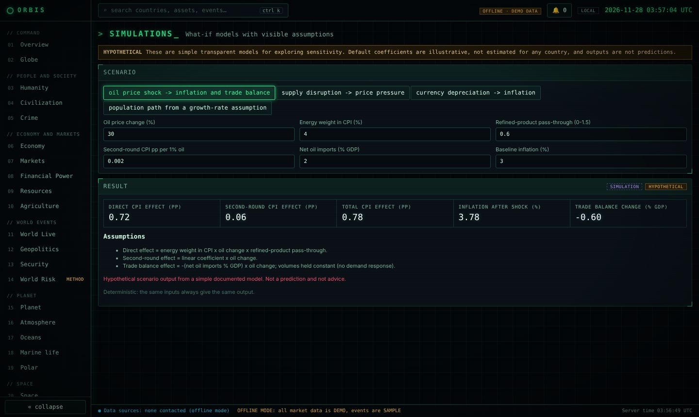 | 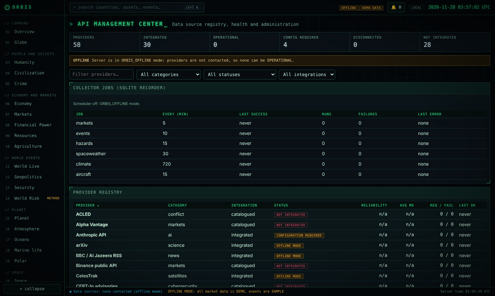 |

<details><summary>More: boot, markets, space, atmosphere, history, AI analyst, mobile</summary>

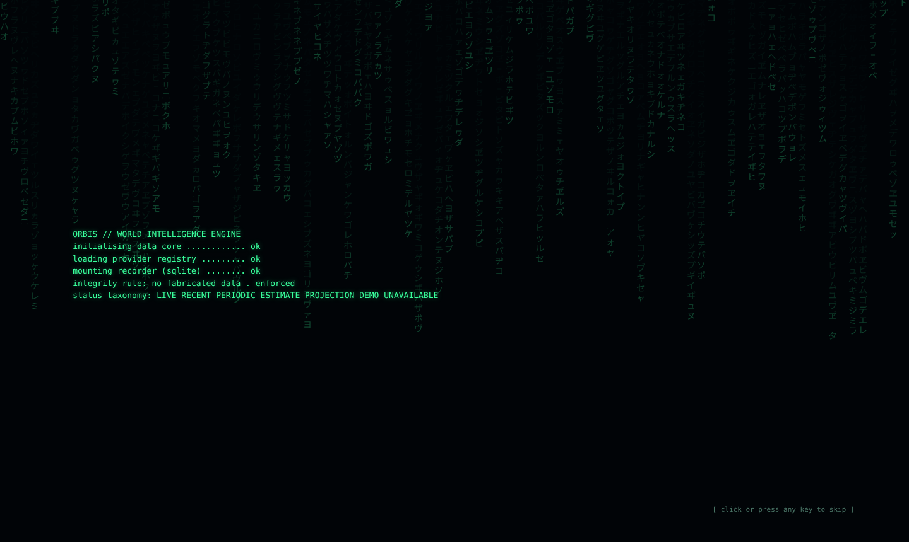
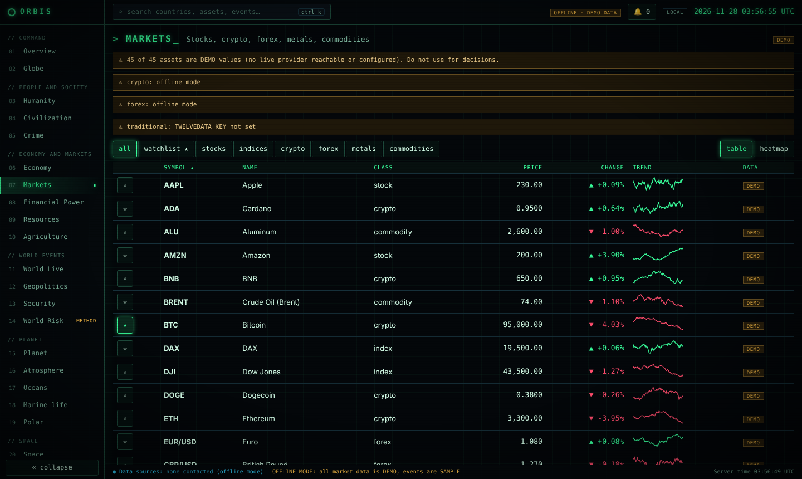
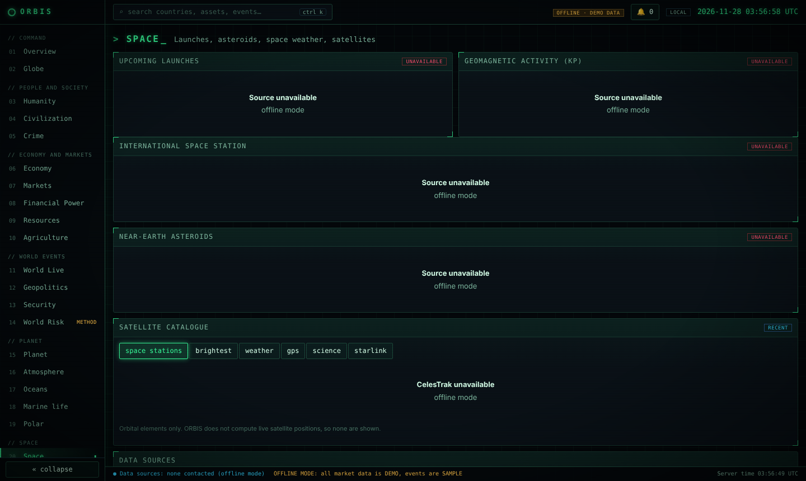
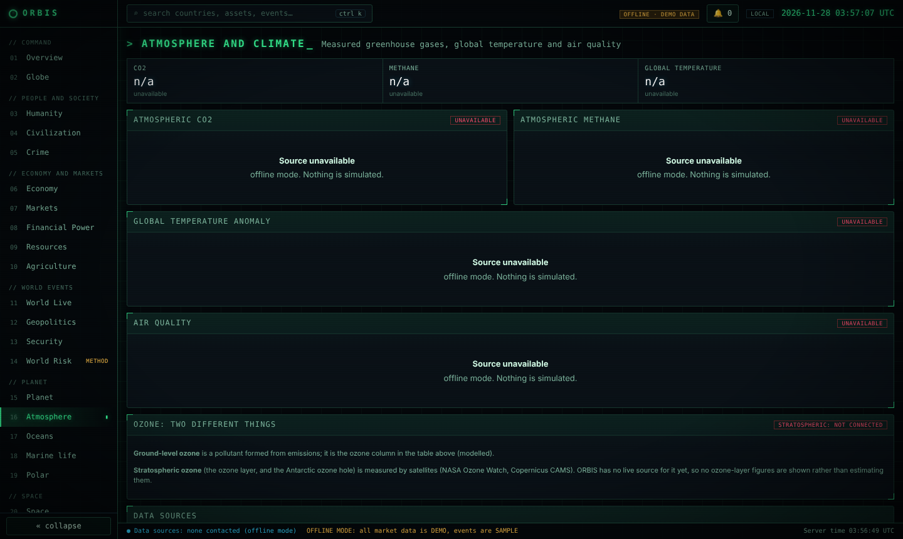
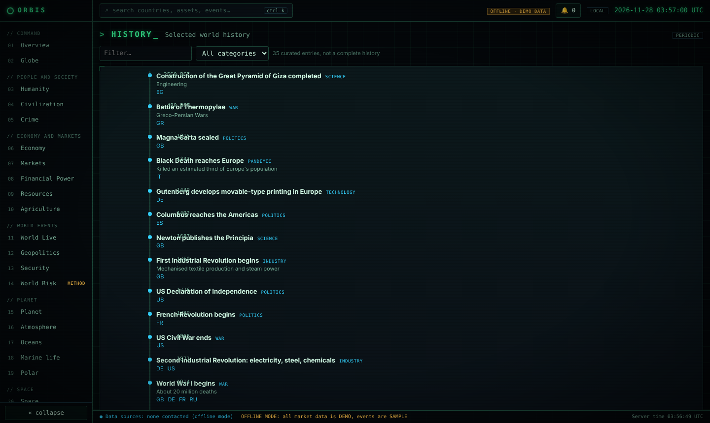
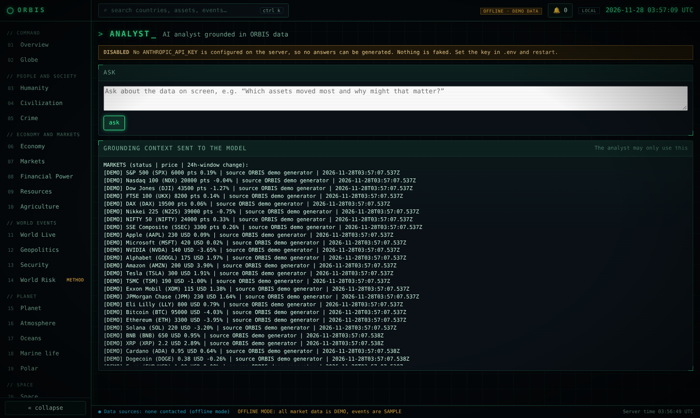

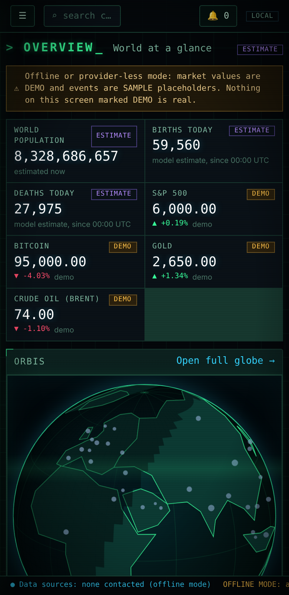
</details>

## What is in it
42 modules in 10 groups:

| Group | Modules |
|---|---|
| Command | Overview, Globe |
| People and society | Humanity, Civilization, Crime |
| Economy and markets | Economy, Markets, Financial Power, Resources, Agriculture |
| World events | World Live, Geopolitics, Security, World Risk |
| Planet | Planet, Atmosphere, Oceans, Marine life, Polar |
| Space | Space, Astronomy |
| Transport | Aviation, Maritime, Railways, Roads, Logistics |
| Knowledge | Science, Technology, Discovery, Cybersecurity, Megaprojects |
| Time and models | Rise and Fall, Connections, History, Forecast, Simulations, Universe Clock, AI Analyst, Reports |
| System | Watchlists, API Center, Settings |

**Highlights**
- Interactive globe: drag, zoom, country select, day/night, and clickable layers for earthquakes, NASA hazards, launch pads, aircraft and the live ISS.
- Anomaly detection (median/MAD) and alert rules with in-app notifications.
- Deterministic what-if simulations, always labelled SIMULATION / HYPOTHETICAL.
- CSV and print-to-PDF reports.
- API Center: ~50-provider registry, health, test connection, custom providers behind an SSRF guard.
- SQLite recorder: prices, Kp, CO2, events and more are stored over time. Only real data is written. See `DATABASE_SCHEMA.md`.

## How honesty works
Every value carries a status badge. Click it for provider, source, frequency and timestamp.

| Status | Meaning |
|---|---|
| LIVE / RECENT | Provider data, live or recently updated |
| PERIODIC | Published on a schedule (daily to annual) |
| ESTIMATE / PROJECTION | Computed by ORBIS from a stated model, not an observation |
| DEMO | Sample values, never real |
| UNAVAILABLE | Source failed or is not configured |

Births and deaths counters are a **model**, not a live count. World Risk shows methodology only until real inputs are connected. Details: `docs/DATA_HONESTY.md`, `DEVELOPMENT_STATUS.md`.

## Configuration
Keys live in `.env` on the server and never reach the browser. Without a key, the feature shows CONFIGURATION REQUIRED.

| Variable | Purpose |
|---|---|
| `ORBIS_OFFLINE` | `1` = never contact providers |
| `ORBIS_ADMIN_TOKEN` | enables API Center admin actions |
| `ORBIS_DB`, `ORBIS_SCHEDULER` | recorder file and on/off |
| `ORBIS_CONTACT` | contact string for the SEC EDGAR User-Agent |
| `TWELVEDATA_KEY`, `FRED_API_KEY`, `NASA_API_KEY`, `ALPHAVANTAGE_KEY` | optional provider keys (see `.env.example`) |
| `ANTHROPIC_API_KEY` | enables the AI Analyst |

## Layout
```
server/    providers/ (adapters), core/ (catalogue, db, scheduler), intelligence/ (signals, anomalies, alerts, forecast),
           services.js (live vs demo decisions), api.js (REST + static files)
web/       index.html, css/ (orbis.css + hacker.css theme), js/ (modules, components, globe, fx)
tests/     server tests    docs/  architecture, data sources, API, security, deployment, screenshots
```

## Status
Early but working. Live connectivity of each provider is **unverified** until you run it on a networked machine. See `DEVELOPMENT_STATUS.md` and `ROADMAP.md` for what is pending.
